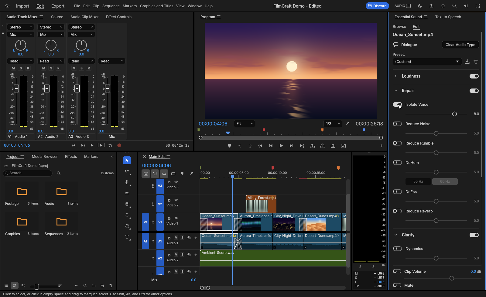
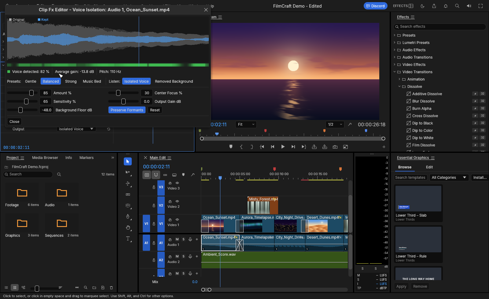

# Voice Isolation — user guide

Voice Isolation keeps the person talking and removes what's around them. You can reach it in
four places in FilmCraft; they all drive the same effect, so use whichever fits your workflow.

- [The one-switch way: Essential Sound](#the-one-switch-way-essential-sound)
- [As an effect: Effects panel and Effect Controls](#as-an-effect-effects-panel-and-effect-controls)
- [The Voice Isolation editor](#the-voice-isolation-editor)
- [On a whole track: Audio Track Mixer](#on-a-whole-track-audio-track-mixer)
- [The controls](#the-controls)
- [Recipes](#recipes)
- [Checking your result](#checking-your-result)
- [Automation, scripts and agents](#automation-scripts-and-agents)
- [Good to know](#good-to-know)

## The one-switch way: Essential Sound

1. Select one or more dialogue clips in the timeline.
2. **Window ▸ Essential Sound**, then click **Dialogue** (skip this if the clips already have a type).
3. Open **Repair** and switch on **Isolate Voice**. It's the first row.
4. The slider under it (0–10, default 8) is the strength. Each step is 10 % of *Amount*.



Essential Sound adds a Voice Isolation effect to each clip for you. It appears in Effect Controls
like any other effect, where you can fine-tune the other settings or keyframe it. Switching the
**Repair** section off bypasses it, and switching **Isolate Voice** off removes it.

Order in the chain: Reduce Rumble → **Isolate Voice** → Reduce Noise → DeHum → DeEss → Reduce
Reverb → Clarity. You rarely need Reduce Noise on top of Isolate Voice.

## As an effect: Effects panel and Effect Controls

1. **Window ▸ Effects**, open **Audio Effects ▸ Noise Reduction/Restoration**, or type `voice`
   in the search box.
2. Drag **Voice Isolation** onto an audio clip. A linked video clip works too: the effect goes
   on its audio.
3. **Window ▸ Effect Controls** shows its settings. Every number can be keyframed with the
   stopwatch, for example to fade the isolation in as a scene moves into a noisy street.
4. Click **Edit…** on the effect's row to open the [editor](#the-voice-isolation-editor).

## The Voice Isolation editor

Open it from Effect Controls (**Edit…** on the Voice Isolation row) or from a mixer effect slot.



**The view (top).** Three seconds of the clip around the playhead, analysed by the same code
that plays it back:

- grey: the sound going *into* the effect;
- blue: what comes *out* (orange when you listen to the removed background);
- the green strip underneath: where the effect hears a voice (brighter = more certain);
- the thin line: the playhead.

Under it: how much of the window is voice, the average gain applied (how much is being taken
away; more negative = more removed) and the speaker's pitch.

The view updates when you release a slider or move the playhead. It pauses during playback and
while you drag, so editing stays smooth.

**Presets.** One click sets Amount, Sensitivity, Background Floor and Center Focus (one undo step):

| Preset | Amount | Sensitivity | Floor | Center Focus | Use it for |
|---|---|---|---|---|---|
| Gentle | 60 % | 45 % | −30 dB | 15 % | light cleanup that keeps some room sound |
| Balanced | 85 % | 65 % | −48 dB | 30 % | the default; most interviews and vlogs |
| Strong | 100 % | 85 % | −70 dB | 40 % | loud backgrounds, "studio" dry voice |
| Music Bed | 100 % | 90 % | −60 dB | 70 % | dialogue over music or a stereo ambience |

**Listen.** *Isolated Voice* is the normal output. *Removed Background* plays only what the
effect takes away. Use it to check that no words are being removed (see
[Checking your result](#checking-your-result)). Voice plus removed background always adds back up
to the original exactly.

**Reset** puts every setting back to its default.

## On a whole track: Audio Track Mixer

To clean a whole dialogue track, including clips you add later:

1. **Window ▸ Audio Track Mixer**, show the effect slots, and pick **Voice Isolation** in an
   empty slot of the track.
2. Click the slot's edit button for the editor. For a track, the view shows the track's mixed
   input.

## The controls

| Control | Range (default) | What it does |
|---|---|---|
| **Amount** | 0–100 % (85 %) | How much of the effect's reduction is applied, measured in decibels: 50 % removes half as many dB as 100 %. 0 % passes the sound through unchanged. |
| **Sensitivity** | 0–100 % (65 %) | How strict it is about what counts as voice. Higher removes more background, including between words, but can start to thin out quiet syllables. Lower is gentler and more natural. |
| **Background Floor** | −80 to −6 dB (−48 dB) | The most the background is ever turned down. −48 dB is close to silence; −20 dB leaves a little room tone so cuts between clips don't sound dead. |
| **Preserve Formants** | on/off (on) | While someone is speaking, it limits how hard the 200 Hz–4 kHz vowel band can be cut (at most 14 dB). This keeps voices full instead of "underwater", at the cost of a little background under the words. |
| **Center Focus** | 0–100 % (30 %) | Stereo clips only: turns down sound that isn't in the middle of the stereo image. Dialogue is normally centred, and music and ambience often aren't. Set it to **0** for two different microphones on left and right (lav on one side, boom on the other). |
| **Output Gain** | −24 to +24 dB (0 dB) | Level after the effect. |
| **Output** | Isolated Voice / Removed Background | What you hear (the editor's *Listen* switch). |

All the numbers can be keyframed. *Preserve Formants* and *Output* are switches.

## Recipes

**Interview in a noisy room (HVAC, fridge, computer fans).** The default works. If the voice
sounds thin, lower Sensitivity to about 50 %.

**Street or vlog (traffic, wind rumble).** Use *Balanced* or *Strong*. For wind rumble, also
switch on Essential Sound's *Reduce Rumble*, or use a Highpass effect before Voice Isolation.

**Dialogue over music.** Use *Music Bed*. Center Focus helps a lot when the music is a stereo mix
and the voice is centred. If the music is mono or centred too, the effect can only lower it
during pauses and between harmonics, so expect a quieter music bed, not silence.

**Two mics on left and right.** Set Center Focus to 0 %. Better still, split the channels first
(Modify ▸ Audio Channels) and isolate each mono clip.

**Hum (50/60 Hz buzz).** Voice Isolation lowers it, but Essential Sound's DeHum removes it more
cleanly. Use both.

**Echo / reverb.** Voice Isolation doesn't remove the room's reverb from the voice itself, only
between words. Add Reduce Reverb (DeReverb) after it.

**Keep a bit of atmosphere.** Background Floor at −18 to −24 dB, or the *Gentle* preset.

**Fade isolation in or out across a cut.** Keyframe Amount from 0 % to 85 % over half a second.

## Checking your result

1. Switch **Listen** to *Removed Background* and play the clip. You should hear the background
   and only faint, ghostly traces of the voice.
2. If you hear clear words in it, the effect is removing speech. Lower *Sensitivity* first, then
   *Amount*, and keep *Preserve Formants* on.
3. Switch back to *Isolated Voice* before exporting! The Output setting is part of the effect, so
   it is exported exactly as set.

## Automation, scripts and agents

Everything is a FilmCraft command, so the control channel, MCP and macros can drive it:

```json
{"command": "effects.apply",    "params": {"clips": [42], "effect": "voice_isolation"}}
{"command": "effects.setParam", "params": {"clip": 42, "effect": "voice_isolation", "param": "amount", "value": 100}}
{"command": "effects.setParam", "params": {"clip": 42, "effect": "voice_isolation", "param": "listen", "value": "Removed Background"}}
{"command": "essentialSound.set", "params": {"clips": [42], "values": {"repair.isolate.on": true, "repair.isolate.amount": 7}}}
{"command": "mixer.addInsert",  "params": {"strip": "A1", "effect": "voice_isolation"}}
{"command": "mixer.setInsert",  "params": {"strip": "A1", "slot": 0, "params": {"sensitivity": 80, "center_focus": 0}}}
```

Parameter ids: `amount`, `sensitivity`, `floor`, `preserve_formants`, `center_focus`, `output`,
`listen` (0 or `"Isolated Voice"`, 1 or `"Removed Background"`). The effect can also be applied by
its name, `"Voice Isolation"`.

UI automation ids: `essentialSound.repair.isolate.on` / `.amount`;
`effectControls.effect.voice_isolation.edit`; in the editor, `fxEditor.voice_isolation.` followed
by `view`, `voice`, `preset.gentle|balanced|strong|music`, `listen.0|1`,
`param.amount|sensitivity|floor|center_focus|output`, `toggle.preserve_formants`, `reset`, `close`.

## Good to know

- **Delay is compensated.** The effect looks about 64 ms ahead (at 48 kHz) so it doesn't clip the
  starts of words. FilmCraft compensates that automatically and sample-exactly: the clip stays in
  sync with the picture.
- **Speed.** About 30× faster than real time on one CPU core for stereo at 48 kHz, so many
  clips can play at once.
- **Seeking.** After a jump in the timeline, the effect re-learns the background from the 1.5 s
  before the playhead. Clip starts are handled specially: digital silence before a clip is not
  mistaken for "no background".
- **Channels.** Mono, stereo and 5.1. One decision is made for all channels together, so the
  stereo image doesn't wander.
- **Not a neural network.** It works on the signal itself, locally, without uploading anything.
  See [HOW-IT-WORKS.md](HOW-IT-WORKS.md#limits) for where that matters.
